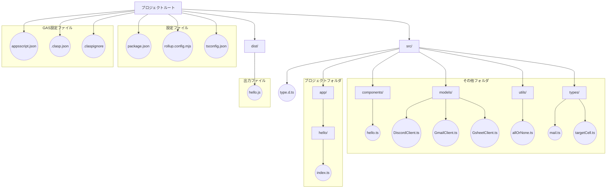

# プロジェクト構造 (`docs/structure.md`)

他のスクリプトでも共有して使うファイルは`src/`の各フォルダ（`models`, `utils`, `components`など）に配置し、
プロジェクト固有で使うファイルは`src/app/`内のプロジェクトフォルダにそれぞれ配置する。
(なるべく`index.ts`は呼び出しのみに専念するようにし、`index.ts`の見通しが良いようにする。)
